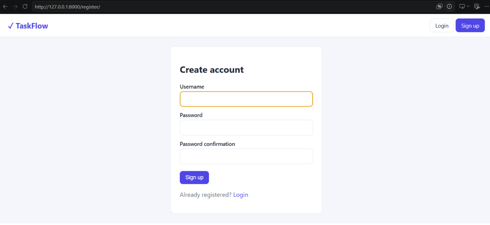
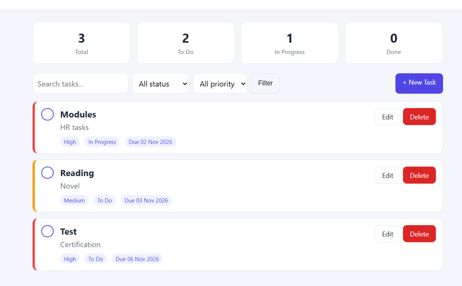
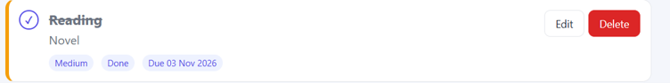

# TaskFlow - Task Management System

A full-stack task management web application built with **Python, Django and MySQL**. Users can sign up, log in and manage their own tasks with priorities, statuses and due dates.

**Live demo:** _add your PythonAnywhere link here_

## Screenshots









## Features

- User registration, login and logout
- Each user sees only their own tasks
- Create, edit and delete tasks
- Mark tasks as done with one click
- Priority (Low, Medium, High) and status (To Do, In Progress, Done)
- Due dates with overdue highlighting
- Search and filters by status and priority
- Dashboard with task counts
- Django admin panel

## Tech Stack

| Layer | Technology |
|-------|------------|
| Backend | Python, Django 5.2 |
| Database | MySQL 8.0 (SQLite supported for quick testing) |
| Frontend | HTML, CSS, JavaScript |
| Tools | Git, GitHub, VS Code |

## Project Structure

```
taskmanager/
├── config/        # Django settings and URLs
├── tasks/         # Models, views, forms, URLs
├── templates/     # HTML templates
├── static/        # CSS and JavaScript
├── manage.py
└── requirements.txt
```

## Setup (Windows)

1. Clone the repository
   ```
   git clone https://github.com/arunapadma20/taskmanager_django.git
   cd taskmanager_django
   ```
2. Create and activate a virtual environment
   ```
   python -m venv venv
   venv\Scripts\activate
   ```
3. Install packages
   ```
   pip install -r requirements.txt
   ```
4. Create the MySQL database
   ```sql
   CREATE DATABASE taskmanager_db CHARACTER SET utf8mb4;
   ```
5. Set your database credentials (environment variables)
   ```
   $env:DB_USER='your_mysql_user'
   $env:DB_PASSWORD='your_mysql_password'
   ```
6. Create the tables and run the server
   ```
   python manage.py makemigrations tasks
   python manage.py migrate
   python manage.py runserver
   ```
7. Open http://127.0.0.1:8000/

To try the app without MySQL, set `USE_SQLITE=1` before step 6.

## What I Learned

- Building a full CRUD application with Django models, views and templates
- User authentication and per-user data access
- Connecting Django to MySQL and managing configuration with environment variables
- Version control with Git and GitHub

## Author

Aruna P - [GitHub](https://github.com/arunapadma20)
